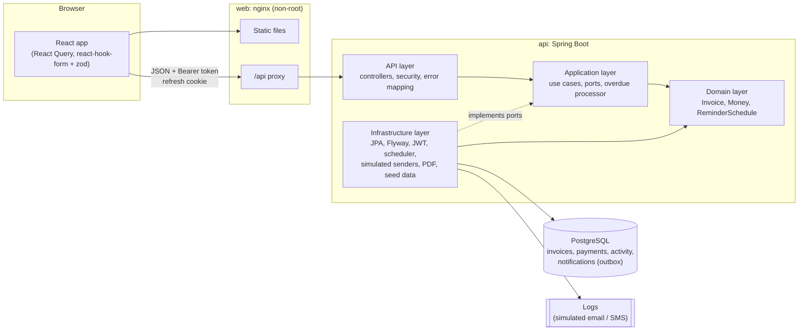
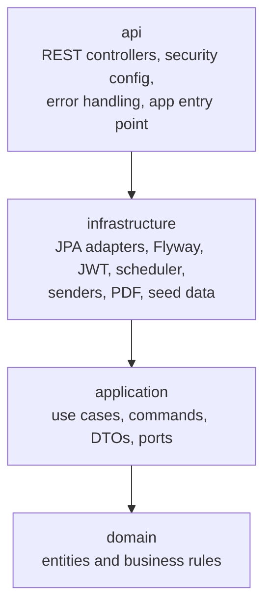
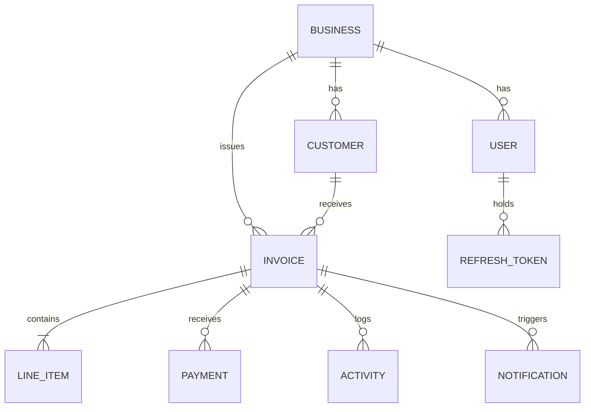
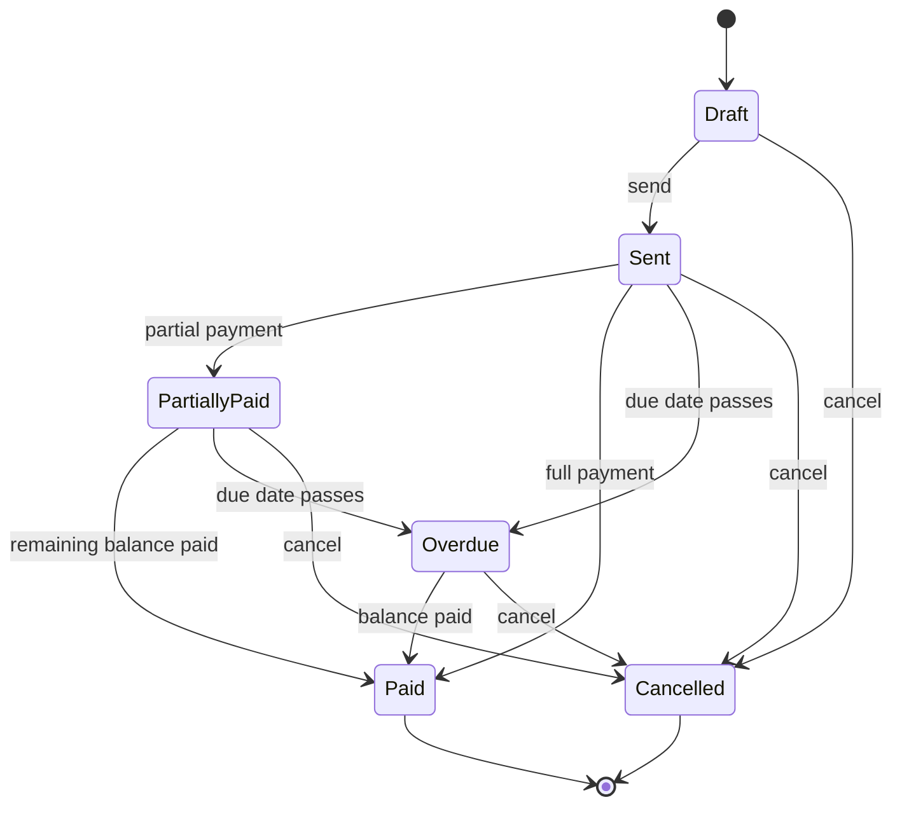
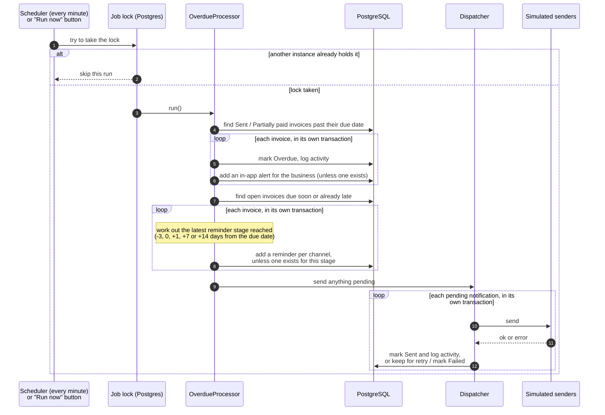

# Architecture

This document explains how the Business Invoice Tracker is built and why. For setup and running instructions, see the [README](README.md).

## Contents

1. [The big picture](#1-the-big-picture)
2. [Backend layers](#2-backend-layers)
3. [Frontend structure](#3-frontend-structure)
4. [Data model](#4-data-model)
5. [Invoice lifecycle](#5-invoice-lifecycle)
6. [How overdue detection and reminders work](#6-how-overdue-detection-and-reminders-work)
7. [Key design decisions](#7-key-design-decisions)
8. [Security](#8-security)
9. [Error handling and API conventions](#9-error-handling-and-api-conventions)
10. [Observability](#10-observability)
11. [Testing strategy](#11-testing-strategy)
12. [Deployment and CI](#12-deployment-and-ci)
13. [Scaling and what I'd change for production](#13-scaling-and-what-id-change-for-production)

---

## 1. The big picture



Three containers make up the system:

| Container | What it does |
|---|---|
| **web** | nginx serves the built React app and forwards anything under `/api` to the backend. The browser only ever talks to one address, so there are no cross-origin requests and the refresh cookie can be `SameSite=Strict`. |
| **api** | The Spring Boot backend: REST API, business rules, and the background job that handles overdue invoices and reminders. |
| **db** | PostgreSQL 16. Flyway creates and migrates the schema when the API starts. |

---

## 2. Backend layers

The backend is a Maven project with four modules. Each layer only depends on the ones inside it, so the business rules never depend on HTTP, SQL or email.



| Module | Contains | Depends on |
|---|---|---|
| `domain` | The core model and its rules. `Invoice` owns the status transitions, totals, payments and overdue check. Also `Money`, `ReminderSchedule` and `Notification`. | JPA annotations only |
| `application` | Use cases such as `InvoiceService`, `AuthService` and `OverdueProcessor`. Commands with validation rules, response DTOs, and **ports**: interfaces like `InvoiceRepository`, `NotificationSender`, `JobLock` and `ClockControl` that the use cases need but don't implement. | domain, Spring context and transactions |
| `infrastructure` | The implementations of those ports: Spring Data JPA repositories, Flyway migrations, invoice numbering, SQL queries for the dashboard, JWT signing, password hashing, the simulated senders and message templates, the Postgres job lock, the scheduler, PDF rendering and demo data. | application |
| `api` | REST controllers, Spring Security, rate limiting, correlation IDs, error mapping, Swagger, and the configuration that wires everything together. | infrastructure |

**Why the ports matter:** the use cases can be tested with simple in-memory fakes, and swapping a technology (a real SMS provider, a different database) means writing one new adapter without touching the business logic.

**Request flow, e.g. recording a payment:**

1. `InvoiceController` receives `POST /api/v1/invoices/{id}/payments`. Spring validates the body, and the caller's business ID comes from the signed token.
2. `InvoiceService.recordPayment` loads the invoice **for that business only**, then calls `invoice.recordPayment(...)`.
3. The `Invoice` entity checks the rules (status allows payments, amount is positive and not more than the balance, idempotency key not reused with a different amount), updates the totals and status, and adds an activity entry.
4. The repository saves it in one transaction, and the controller returns the updated invoice.

---

## 3. Frontend structure

```
frontend/src/
├── api/           typed API client: token handling, refresh on 401, error parsing
├── auth/          sign-in state, protected routes
├── components/    shared UI (buttons, form fields, modal, badges) and the app layout
├── features/      one folder per screen
│   ├── dashboard/
│   ├── invoices/      list, editor, detail page, payment form
│   ├── customers/
│   ├── notifications/
│   ├── settings/      business profile
│   └── dev/           the demo time machine
└── lib/           formatting, query keys, small hooks
```

- **Server state** lives in React Query: caching, background refresh, and invalidation after changes. The notification count refreshes every 30 seconds.
- **Forms** use react-hook-form with zod schemas, so the browser checks input before sending. The server still validates everything.
- **Invoice list filters** are stored in the URL, so a filtered view can be bookmarked or shared.
- **Accessibility:** form errors are linked to their fields, dialogs trap focus and close on Escape, the chart has a text description, and there's a skip-to-content link. ESLint runs the jsx-a11y rules.

---

## 4. Data model



- **The business is the tenant.** Every customer, invoice and notification has a `business_id`, and every query filters on it.
- **Invoices store their totals** (subtotal, VAT, total, amount paid), so lists and the dashboard can add them up in SQL without loading line items.
- **`notifications` is an outbox table:** each reminder is a row with channel, recipient, rendered message, status and attempt count.
- **Important constraints in the database:**
  - `(business_id, number)` is unique, so there are no duplicate invoice numbers.
  - `(invoice_id, idempotency_key)` is unique on payments, so the same payment can't be recorded twice.
  - `(invoice_id, stage, channel)` is unique on notifications, so the same reminder can't be generated twice.
  - Check constraints keep `amount_paid` between 0 and the total, and the due date on or after the issue date.

---

## 5. Invoice lifecycle



- Only **Draft** invoices can be edited.
- A partial payment on an **Overdue** invoice keeps it overdue until it's paid in full.
- Any move not shown above (for example Paid → Cancelled, or sending twice) is rejected with `409 Conflict`. The response says the current and the requested status.
- Every transition is recorded in the invoice's activity history.

---

## 6. How overdue detection and reminders work

This is the heart of the brief.



**When is an invoice overdue?** When it's Sent or Partially paid, has a balance left, and its due date is **before today in the business time zone** (`Africa/Johannesburg` by default). The rule lives in `Invoice.markOverdueIfDue`. The same check also runs when an already-late invoice is sent.

**The reminder schedule** is configurable (`APP_REMINDERS_OFFSETS_DAYS`, default `-3,0,1,7,14`). Each run looks for the **latest stage reached today**. If the job was down for a week, the customer gets a single "7 days overdue" reminder, not a burst of every missed one.

**Who gets what:**

| Channel | Recipient | When |
|---|---|---|
| Email | The customer | Every stage |
| SMS | The customer, if they have a phone number | Every stage (can be turned off) |
| In-app alert | The business user (bell icon) | Once, when the invoice becomes overdue |

**Why reminders are never duplicated:**

1. Before adding a reminder, the job checks whether one exists for that invoice, stage and channel.
2. A unique index on those three columns guarantees it at the database level, even if two servers race.
3. A Postgres advisory lock means only one copy of the job runs at a time. The scheduler and the dev "Run now" button share the same lock. If a server crashes, its database connection closes and Postgres releases the lock automatically.
4. Each invoice is handled in its own transaction, so one bad record is logged and skipped instead of stopping the whole run.

**How the simulation works:** the job writes reminders to the `notifications` table as *pending*. The dispatcher hands each one to the `NotificationSender` for its channel. The included senders write a log line, with email addresses and phone numbers partly masked, and the row is marked *sent*. If a sender throws an error, the notification is retried on the next run and marked *failed* after three attempts. Messages are rendered from plain-text templates in `infrastructure/src/main/resources/notification-templates/`.

**Plugging in real email or SMS:** implement `NotificationSender` for the channel (for example with SendGrid or Amazon SES for email, Twilio or Clickatell for SMS) and register it in place of the simulated one. Nothing else changes.

**Testing time:** everything reads the time from an injected `java.time.Clock`.
- Unit tests use a clock they can move forward, so "20 days pass" runs in milliseconds.
- The demo time machine uses an `AdjustableClock`: real time plus an offset.
- Sign-in token expiry uses a separate real-time clock, so moving the demo clock never logs anyone out.

---

## 7. Key design decisions

**Clean Architecture, with one pragmatic shortcut.** The business rules sit in the domain and application layers and are covered by fast unit tests (72 of them). The trade-off is more files than a simple layered CRUD app. One shortcut: the domain entities carry JPA annotations instead of having separate database models. That avoids a lot of mapping code, and the rules are still enforced through methods rather than public setters.

**Money.** `BigDecimal` everywhere, stored as `numeric(14,2)`. VAT is rounded half-up **per line**, so the line totals always add up to the invoice total. The browser shows a live preview using the same rounding, but the server recalculates everything and ignores any totals the client sends.

**Invoice numbers** (`INV-2026-0001`) come from one SQL statement: an insert-or-increment on a per-business, per-year counter, inside the same transaction as the invoice.
- If the invoice fails to save, the number is released, so there are no gaps.
- Two invoices created at the same moment can't get the same number, because the counter row is locked until the transaction ends.

**Optimistic concurrency.** Draft edits use HTTP `ETag` / `If-Match` headers backed by a version column. If two people edit the same draft, the second save gets `412 Precondition Failed` instead of silently overwriting the first.

**Idempotent payments.** The client sends an `Idempotency-Key` header with each payment. Retrying with the same key returns the original result (`200`, with `Idempotent-Replayed: true`) instead of recording the payment again. The frontend generates one key each time the payment dialog opens, so a double-click is harmless.

**Dashboard queries in SQL.** Totals, ageing buckets and the most-overdue list are calculated by the database in a few aggregate queries, not by loading invoices into memory.

---

## 8. Security

| Concern | How it's handled |
|---|---|
| **Passwords** | BCrypt (cost 12). Sign-in spends the same time hashing for unknown emails, so response timing doesn't reveal which accounts exist. Wrong email and wrong password give the same message. |
| **Access tokens** | JWT signed with HS256, valid for 15 minutes, kept only in browser memory (never `localStorage`). |
| **Refresh tokens** | Random 256-bit values, stored only as a SHA-256 hash, valid for 7 days. Sent as an `HttpOnly`, `SameSite=Strict` cookie scoped to `/api/v1/auth`. Each use replaces the token. Reusing an old one is treated as theft and signs out every session of that user. |
| **Tenant isolation** | The business ID comes only from the signed token, never from the request, and every query filters on it. Another business's records return `404`, so you can't even tell they exist. Integration tests check this. |
| **Brute force** | Sign-in and registration are rate-limited per IP address (10 per minute by default), returning `429` with `Retry-After`. |
| **Input** | Request bodies are validated (lengths, formats, ranges). Free text is trimmed and stripped of control characters. Messages are plain text, so customer data can't inject markup. |
| **Headers** | The API sends a strict Content-Security-Policy, `X-Frame-Options: DENY`, `nosniff`, `Referrer-Policy` and HSTS. nginx sends a suitable policy for the web app. |
| **Secrets** | None in the code. The JWT secret is required at start-up and must be at least 32 bytes, otherwise the app refuses to start. |
| **Containers** | Both images run as non-root users. |

---

## 9. Error handling and API conventions

- All endpoints are versioned under `/api/v1`.
- Every error is returned as RFC 7807 *problem details* (`application/problem+json`), with a stable `code` the frontend can rely on and a `correlationId` that matches the server logs. Unexpected errors return a generic message and never leak internals.

| Status | When |
|---|---|
| `400` | Validation failed (includes an `errors` list per field), or a malformed request |
| `401` | Not signed in, or the token is invalid or expired |
| `404` | Not found, or it belongs to another business |
| `409` | Invalid status change, duplicate email, customer still has invoices, or a concurrent change |
| `412` | The `If-Match` version is out of date |
| `422` | A business rule was broken (e.g. overpayment, editing a sent invoice, payment date in the future) |
| `428` | `If-Match` is missing on a draft update |
| `429` | Too many sign-in attempts |

Full request and response schemas are in Swagger at http://localhost:8080/swagger-ui.html.

---

## 10. Observability

- **Logs:** in Docker the API writes structured JSON logs, one event per line, ready for a log collector. Every line includes a **correlation ID**: taken from the `X-Correlation-Id` request header if it's safe, otherwise generated, and returned in the response. Background job runs get their own ID.
- **Health checks:** `/health/live` says the process is running; `/health/ready` also checks the database. Docker Compose uses them to start services in the right order, and they map directly onto Kubernetes probes.
- **Job summaries:** each overdue run logs how many invoices became overdue, how many reminders were queued, sent or failed, and any errors.

---

## 11. Testing strategy

| Level | Tools | What's covered |
|---|---|---|
| **Domain unit tests** | JUnit 5, AssertJ | Money and VAT rounding, the full status transition matrix, payments and idempotency, overdue detection, the reminder schedule |
| **Application unit tests** | JUnit 5, in-memory fakes, controllable clock | The overdue processor over simulated weeks (escalation, no duplicates, retries, locking), sign-in token rotation and theft detection |
| **Integration tests** | Spring Boot test, Testcontainers (real PostgreSQL) | The running app over HTTP: sign-in flows, tenant isolation, invoice lifecycle, concurrency, idempotent payments, filters and paging, PDF, dashboard, the overdue job end to end, demo seeding, health, security headers and CORS behind a proxy |
| **Frontend unit tests** | Vitest, Testing Library | API client (token refresh, one refresh for many failures, error parsing), invoice form and totals, login form, notification bell |
| **End-to-end** | Playwright | Sign in → create invoice → send → move time forward → run the overdue check → see the alert and the Overdue status |

---

## 12. Deployment and CI

**Images**
- The **API image** is built in stages: compile with the full JDK, then copy the application, split into layers, onto a small JRE image running as a non-root user. Dependencies sit in their own layer, so code changes rebuild quickly.
- The **web image** builds the React app with Node, then serves it from an unprivileged nginx image.
- Both have health checks.

**Compose**
- `docker-compose.yml` starts the database, API and web app in order, waiting for each to be healthy. Every setting has a safe local default, so no `.env` file is needed.
- `docker-compose.test.yml` adds containers that run the test suites, for machines without Java or Node.

**CI** (`.github/workflows/ci.yml`), on every push and pull request:
1. **Backend:** format check, then unit and integration tests.
2. **Frontend:** format check, lint, type check, tests with coverage, production build.
3. **Docker:** build both images, start the full stack, smoke-test it, then run the Playwright test against it.

---

## 13. Scaling and what I'd change for production

**Scaling**
- The API keeps no session state (tokens are self-contained), so you can run several copies behind a load balancer.
- The overdue job is safe on several copies thanks to the lock and the unique constraints. At much larger volumes I'd split the work by business, or switch to a queue where each invoice schedules its own reminders.
- Indexes cover the busy queries: business + status, business + issue date, open invoices by due date (for the job), and pending notifications.
- The dashboard could become a materialised view or a cache if it ever got slow.

**Before going to production I would:**
- Plug in real email and SMS providers, move sending to a separate worker or queue, add exponential back-off, and track delivery through provider webhooks.
- Let customers opt out of reminders, in line with POPIA.
- Move the rate limiter to Redis or the API gateway. It's currently in memory, so the limit applies per server.
- Use asymmetric JWT keys (RS256) with key rotation, and add account lockout and MFA.
- Add metrics and tracing (Prometheus, OpenTelemetry), e.g. job duration and reminders sent or failed.
- Keep secrets in a secret manager, serve over HTTPS with `APP_AUTH_COOKIE_SECURE=true`, and turn off the demo tools and seed data.
- Paginate the activity history, for invoices with a very long history.
