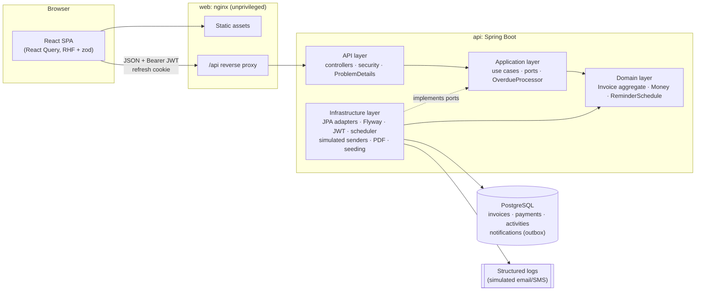
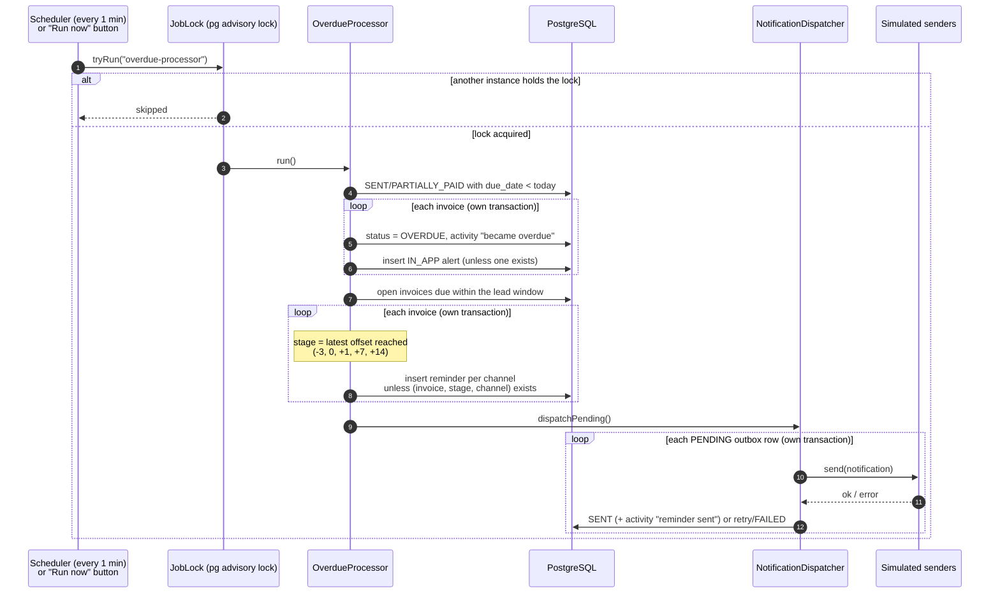

# Business Invoice Tracker

A full-stack system for businesses to create and track invoices, record payments, and chase late payers with **simulated overdue notifications**.

- **Backend:** Java 21, Spring Boot 3.5, Clean Architecture (domain / application / infrastructure / api), PostgreSQL 16, Flyway
- **Frontend:** React 18, TypeScript, Vite, Tailwind CSS, React Query, React Router, react-hook-form + zod
- **Ops:** Docker (multi-stage, non-root), docker compose, GitHub Actions, Testcontainers, Playwright

```bash
docker compose up --build
```

Then open **http://localhost:3000** and sign in with **`demo@acme.co.za` / `Demo@12345`**.

---

## Contents

1. [Features](#features)
2. [Quick start](#quick-start)
3. [Demo: overdue notifications step by step](#demo-overdue-notifications-step-by-step)
4. [Architecture](#architecture)
5. [Design decisions and trade-offs](#design-decisions-and-trade-offs)
6. [Running locally without Docker](#running-locally-without-docker)
7. [Testing](#testing)
8. [API summary](#api-summary)
9. [Configuration reference](#configuration-reference)
10. [Assumptions, limitations and future improvements](#assumptions-limitations-and-future-improvements)

---

## Features

**Business accounts and security**
- Register a business and sign in. Access tokens are short-lived JWTs held in memory; refresh tokens are **rotating, single-use, hashed at rest** and delivered as an `HttpOnly; SameSite=Strict` cookie. Reusing a rotated token revokes every session of that user.
- **Multi-tenant isolation enforced server-side**: the tenant id comes only from the signed token and every query is scoped by it. Another business's resources return `404`, so their existence is never revealed.
- Business profile: name, registration number, VAT number (SA format), address, contact details, currency (ZAR), default payment terms.

**Customers**: create, edit, search, paginate, delete (blocked while they have invoices).

**Invoices**
- Drafts with line items (description, quantity, unit price, VAT 15% or exempt). **Totals are always computed on the server** with `BigDecimal`, rounded per line half-up; any totals sent by the client are ignored.
- Gap-free sequential numbers per business and year: `INV-2026-0001`.
- Due date defaults from the business's payment terms.
- Enforced lifecycle: `DRAFT → SENT → PARTIALLY_PAID → PAID`, `SENT/PARTIALLY_PAID → OVERDUE`, any unpaid → `CANCELLED`. Invalid transitions return `409` with the current and requested status.
- Full or partial payments with date, method and reference. Status updates automatically. **Idempotent** via an `Idempotency-Key` header.
- **Optimistic concurrency** on draft edits via `ETag` / `If-Match` (`412` if stale, `428` if missing).
- Audit trail: created, updated, sent, payment recorded, paid, became overdue, reminder sent, cancelled.
- Search (number or customer), filter (status, customer, issue-date range), sort, paginate. Filters live in the URL, so views can be bookmarked and shared.
- PDF download.

**Simulated overdue notifications** (the core of the brief)
- A scheduled background job (every minute by default) marks overdue invoices and sends reminders on a configurable escalation schedule: **3 days before due, on the due date, 1 / 7 / 14 days overdue**.
- Reminders go to the customer by **email** and, if they have a phone number, **SMS**. The business gets an **in-app alert** when an invoice becomes overdue.
- Notifications are written to an **outbox table** and "delivered" by simulated senders that log instead of sending. No duplicates, no matter how often the job runs.
- **Demo time machine**: move the business clock forward and run the job on demand from the UI.
- Notification bell with unread count (polled), dropdown, and a full notifications log.

**Dashboard**: total outstanding, total overdue, paid this month, counts by status, ageing buckets (current, 1–30, 31–60, 61–90, 90+) with a chart, and the most overdue invoices.

**Production concerns**: RFC 7807 problem responses with stable error codes and correlation ids, Bean Validation, URL API versioning (`/api/v1`), OpenAPI/Swagger, rate-limited auth endpoints, security headers (API and nginx), CORS, input sanitisation, structured JSON logs with correlation ids, liveness/readiness health checks, graceful shutdown, environment-based config with fail-fast validation.

---

## Quick start

**Prerequisites:** Docker with Compose v2 (Docker Desktop or Rancher Desktop with the **dockerd/moby** engine).

```bash
git clone https://github.com/EmmanuelManana/business-invoice-tracker.git
cd business-invoice-tracker
docker compose up --build
```

The first build takes a few minutes (Maven and npm downloads). When all three services report healthy:

| What | URL |
|---|---|
| Web app | http://localhost:3000 |
| API | http://localhost:8080/api/v1 |
| Swagger UI | http://localhost:8080/swagger-ui.html |
| OpenAPI JSON | http://localhost:8080/v3/api-docs |
| Health (liveness / readiness) | http://localhost:8080/health/live · http://localhost:8080/health/ready |

**Demo login:** `demo@acme.co.za` / `Demo@12345`. You can also register a new business from the sign-in page.

The demo business ("Acme Creative Studio") is seeded with 8 customers and 16 invoices in every status, including overdue invoices in each ageing bucket. Within about 15 seconds of start-up the job runs and the notification bell fills up.

No `.env` file is needed: every setting has a local default in `docker-compose.yml`. To override, `cp .env.example .env` and edit. Stop with `docker compose down`; add `-v` to wipe the database.

> The compose defaults (JWT secret, DB password, demo tools on) are for local demos only. See [Configuration](#configuration-reference) for what to change in a real deployment.

---

## Demo: overdue notifications step by step

1. Sign in as `demo@acme.co.za`. The **Dashboard** shows the *Demo time machine* card and the seeded overdue balances.
2. Go to **Invoices → New invoice**. Pick a customer that has a phone number (e.g. *Karoo Coffee Roasters*), set the **due date to tomorrow**, add a line, **Save draft**.
3. On the invoice page click **Mark as sent**.
4. Back on the Dashboard, click **+1 day**. The business date moves forward and nothing else happens yet: the invoice is due *today*.
5. Click **Run overdue check now**. A "due today" (`D0`) reminder is sent by email and SMS. Open **Notifications** to read the rendered messages.
6. Click **+1 day** and **Run overdue check now** again. The invoice is now **Overdue**: you get an in-app alert (the bell's count goes up) and the customer gets the "1 day overdue" (`D+1`) reminder.
7. Click **Run overdue check now** again: **nothing new is sent** (idempotent).
8. Click **+7 days** and run again: the `D+7` escalation goes out. The invoice's **Activity** timeline records each step.
9. Record a payment for the balance on the invoice page: it becomes **Paid**, and no more reminders are sent.
10. Click **Reset** to return to real time.

You don't have to click "Run now": the scheduler runs every minute, so after moving the clock the job picks the change up on its own within a minute.

The same can be driven through the API (`POST /api/v1/dev/clock/advance {"days": 7}`, `POST /api/v1/dev/overdue-check`) or Swagger.

---

## Architecture



**Backend modules** (`backend/`), with dependencies pointing inwards only:

| Module | Contains | Depends on |
|---|---|---|
| `domain` | Entities and value objects with business rules: `Invoice` (status machine, totals, payments, overdue detection), `Money`, `ReminderSchedule`, `Notification` | JPA annotations only |
| `application` | Use cases (`InvoiceService`, `AuthService`, `OverdueProcessor`, …), commands/DTOs with validation, **ports** (`InvoiceRepository`, `NotificationSender`, `JobLock`, `ClockControl`, …) | domain, Spring context/tx |
| `infrastructure` | Adapters for the ports: Spring Data JPA, Flyway migrations, invoice numbering, SQL dashboard read model, JWT, BCrypt, simulated senders, templates, advisory lock, scheduler, PDF, seed data | application |
| `api` | REST controllers, Spring Security, rate limiting, correlation ids, error mapping, OpenAPI, configuration (composition root) | infrastructure |

**Frontend** (`frontend/src/`): `api/` (typed client with token refresh and problem parsing), `auth/`, `components/` (accessible UI kit and layout), `features/*` (one folder per screen: dashboard, invoices, customers, notifications, settings, dev tools), `lib/` (formatting, query keys).

### How the overdue job works



---

## Design decisions and trade-offs

**Why Clean Architecture.** Business rules (status transitions, VAT, idempotent payments, reminder escalation) live in the domain and application layers, which have no knowledge of HTTP, SQL or email. That makes the most important logic unit-testable in milliseconds with in-memory fakes. 72 domain and application tests cover it. It also means swapping a delivery channel or storage engine touches one adapter. The cost is more types and mapping than a layered CRUD app. *Pragmatic trade-off:* domain entities carry JPA annotations (an API-only dependency, no Hibernate or Spring types) instead of having separate persistence models. That avoids a large mapping layer, and invariants are still enforced through methods rather than setters.

**Money.** `BigDecimal` end to end (Postgres `numeric(14,2)`), rounded half-up **per line** so line totals always sum to the invoice total. Totals are denormalised on the invoice so lists and the dashboard can aggregate in SQL. The client shows a live preview using the same rounding, but the server is authoritative.

**Invoice numbers** come from a single `INSERT … ON CONFLICT DO UPDATE … RETURNING` on a per-business, per-year counter row, inside the invoice's transaction. That makes them gap-free (a rolled-back invoice releases its number) and safe under concurrency (the row lock serialises creation per business). A unique constraint on `(business_id, number)` is the backstop.

**How overdue detection works.** An invoice is overdue when it is `SENT` or `PARTIALLY_PAID`, its due date is **before today in the business time zone** (`Africa/Johannesburg`), and it still has a balance. The check lives in `Invoice.markOverdueIfDue` and runs from the job, and also when an already-late invoice is sent. A partial payment on an overdue invoice keeps it overdue until it is paid in full.

**How reminders avoid duplicates.** For each open invoice the job asks the schedule for the **latest stage reached today**. If the job was down for a week the customer gets one "7 days overdue" reminder, not a burst of every missed stage. A reminder is only inserted if none exists for `(invoice, stage, channel)`, and a **unique index on those columns** guarantees it even if two instances race. A Postgres **advisory lock** additionally ensures only one instance runs the job at a time (the scheduler and the "Run now" button use the same lock). Each invoice is processed in its own transaction, so one bad record is logged and skipped.

**How notifications are simulated.** The job writes rows to a `notifications` **outbox** (channel, recipient, rendered subject/body, status, attempts, timestamps). A dispatcher hands each `PENDING` row to the `NotificationSender` for its channel. The bundled senders log a structured line, with recipients masked to avoid PII in logs, and the row is marked `SENT`. Failures are retried on later runs and marked `FAILED` after `max-delivery-attempts`. Messages are rendered from plain-text templates in `infrastructure/src/main/resources/notification-templates`.

**Plugging in real email/SMS.** Implement `NotificationSender` for the channel (e.g. Amazon SES or SendGrid for `EMAIL`, Twilio or Clickatell for `SMS`) and register it instead of the simulated bean. Nothing else changes. For production I would also:
- move dispatch to its own worker, or onto a queue (SQS/RabbitMQ), so slow providers never delay overdue detection;
- add exponential backoff (`next_attempt_at`) and provider idempotency keys (the notification id);
- process delivery webhooks (bounced, delivered, opened) to update status;
- add HTML email templates and per-customer channel preferences and opt-out (POPIA).

**Time is injected.** Everything reads a `java.time.Clock`. Tests use a mutable clock to simulate days passing; the dev tools shift an `AdjustableClock` (system time plus offset). Security-related time (token expiry) uses a separate real-time clock, so moving the demo clock never signs anyone out.

**Auth.** Access token: HS256 JWT, 15 minutes, in memory only (never `localStorage`). Refresh token: random 256-bit value, stored as SHA-256, 7 days, rotated on every use, with reuse detection. Sent as an `HttpOnly`, `SameSite=Strict` cookie scoped to `/api/v1/auth`. nginx serves the SPA and proxies `/api`, so everything is same-origin. Passwords use BCrypt (cost 12). Login spends the same hashing time for unknown emails, so timing doesn't reveal which accounts exist.

**Scaling considerations.**
- The API is stateless (JWT), so it scales horizontally. The job is safe on many instances (advisory lock plus unique constraints). For very large volumes, shard the job by business id, or move to a queue-driven design where invoice events schedule their own reminders.
- The dashboard is computed by SQL aggregates (CQRS-lite read model). At scale it could be a materialised view or a cache refreshed by events.
- Indexes cover the hot paths: tenant + status, tenant + issue date, a partial index on open invoices by due date for the job, and a partial index on pending notifications.
- The auth rate limiter is in-memory, so the limit is per instance. Behind a load balancer it should move to Redis or the API gateway.
- Invoice detail loads the aggregate. A long-lived invoice with thousands of activities would need paginated activity.

---

## Running locally without Docker

**Prerequisites:** JDK 21, Node 20+ (22 recommended), PostgreSQL 16. Maven is not needed; use the wrapper.

1. **Database.** Use a local PostgreSQL 16 with a database and user named `invoice_tracker` (password `invoice_tracker`), or start one in Docker:
   ```bash
   docker run --name invoice-db -e POSTGRES_DB=invoice_tracker -e POSTGRES_USER=invoice_tracker -e POSTGRES_PASSWORD=invoice_tracker -p 5432:5432 -d postgres:16-alpine
   ```
2. **API** (the `dev` profile enables demo data, dev tools and a local-only JWT secret):
   ```bash
   cd backend
   ./mvnw -pl api -am spring-boot:run -Dspring-boot.run.profiles=dev
   ```
   Runs on http://localhost:8080. Flyway applies migrations on start-up.
3. **Frontend** (Vite proxies `/api` to `localhost:8080`):
   ```bash
   cd frontend
   npm install
   npm run dev
   ```
   Open http://localhost:5173.

---

## Testing

| Suite | Command | What it covers |
|---|---|---|
| Backend unit | `cd backend && ./mvnw test` | Money and VAT rounding, status transition matrix, payments and idempotency, overdue detection, reminder schedule, overdue processor with a fake clock (escalation, idempotency, retries, locking), auth token rotation and reuse detection, rate limiter |
| Backend unit + integration | `cd backend && ./mvnw verify` | Everything above plus HTTP tests against the real app and **PostgreSQL in Testcontainers**: auth flows, **tenant isolation**, invoice CRUD and lifecycle, ETag concurrency, idempotent payments, filters/sort/paging, PDF, dashboard, the **overdue job end to end**, health, security headers. *Requires Docker.* |
| Backend formatting | `cd backend && ./mvnw spotless:check` (`spotless:apply` to fix) | Palantir Java format |
| Frontend unit | `cd frontend && npm test` | API client (token refresh, single-flight, problem parsing), invoice schema and totals, login form, invoice form (live totals, line items, validation), notification bell |
| Frontend static checks | `npm run lint && npm run typecheck && npm run format:check` | ESLint (incl. jsx-a11y, zero warnings), TypeScript strict, Prettier |
| End-to-end | `docker compose up -d --build --wait`, then `cd frontend && npx playwright install chromium && npm run e2e` | Sign in → create invoice → send → simulate time → run overdue check → see the overdue notification and status |

**Everything in Docker** (no local JDK or Node needed):

```bash
docker compose -f docker-compose.yml -f docker-compose.test.yml run --rm backend-tests   # unit + integration
docker compose -f docker-compose.yml -f docker-compose.test.yml run --rm frontend-tests  # lint, typecheck, unit
docker compose -f docker-compose.yml -f docker-compose.test.yml run --rm e2e             # starts the stack, runs Playwright
docker build --target test ./backend    # backend unit tests only
docker build --target test ./frontend   # frontend checks only
```

**CI** (`.github/workflows/ci.yml`) runs on every push and PR: backend format check + `verify`, frontend format/lint/typecheck/coverage/build, then builds both images, starts the stack with `docker compose up --wait`, smoke-tests it and runs the Playwright test.

---

## API summary

All endpoints are under `/api/v1` and require `Authorization: Bearer <token>` unless marked public. Errors are `application/problem+json` with `status`, `title`, `detail`, a stable `code` and a `correlationId` (also returned in the `X-Correlation-Id` header). Full schemas are in Swagger.

| Method | Path | Notes |
|---|---|---|
| POST | `/auth/register` | Public, rate-limited. Creates business + user. Returns access token and sets refresh cookie |
| POST | `/auth/login` | Public, rate-limited |
| POST | `/auth/refresh` | Public (uses the cookie). Rotates the refresh token |
| POST | `/auth/logout` | Revokes the refresh token, clears the cookie |
| GET | `/auth/me` | Current user and business |
| GET / PUT | `/business/profile` | Business profile and invoicing defaults |
| GET | `/customers?search=&page=&size=` | Paginated, searchable |
| POST | `/customers` | `201` + `Location` |
| GET / PUT / DELETE | `/customers/{id}` | Delete returns `409` if the customer has invoices |
| GET | `/invoices?status=&customerId=&from=&to=&search=&sort=&direction=&page=&size=` | `sort`: issueDate, dueDate, number, total, status, customer |
| POST | `/invoices` | Create draft. `201` + `ETag` |
| GET | `/invoices/{id}` | Detail with lines and payments. `ETag` header |
| PUT | `/invoices/{id}` | Update draft. **Requires `If-Match`** (`412` stale, `428` missing) |
| POST | `/invoices/{id}/send` | `DRAFT → SENT` |
| POST | `/invoices/{id}/cancel` | Body `{ "reason" }` optional |
| POST | `/invoices/{id}/payments` | **Requires `Idempotency-Key`**. `201` new, `200` replay (`Idempotent-Replayed: true`) |
| GET | `/invoices/{id}/activity` | Audit trail, newest first |
| GET | `/invoices/{id}/pdf` | `application/pdf` |
| GET | `/notifications?unreadOnly=&page=&size=` | Outbox for the business, newest first |
| GET | `/notifications/unread-count` | `{ "count": n }` |
| POST | `/notifications/{id}/read` · `/notifications/read-all` | |
| GET | `/dashboard/summary` | Totals, counts by status, ageing buckets, top overdue |
| GET | `/dev/clock` | **Dev tools only.** Business date and offset |
| POST | `/dev/clock/advance` · `/dev/clock/reset` | Body `{ "days": 1-365 }` |
| POST | `/dev/overdue-check` | Run the job now and return what it did |

Status codes: `400` validation (with an `errors` list), `401` unauthenticated, `404` not found or another tenant's, `409` invalid transition / conflict / concurrent modification, `412` stale `If-Match`, `422` business rule (e.g. overpayment, editing a sent invoice), `428` missing `If-Match`, `429` rate limited (`Retry-After`).

---

## Configuration reference

Spring Boot binds environment variables to properties (`APP_AUTH_JWT_SECRET` → `app.auth.jwt-secret`). Configuration is validated at start-up; a missing or short JWT secret stops the app.

| Variable | Default | Purpose |
|---|---|---|
| `SPRING_DATASOURCE_URL` | `jdbc:postgresql://localhost:5432/invoice_tracker` | JDBC URL |
| `SPRING_DATASOURCE_USERNAME` / `_PASSWORD` | `invoice_tracker` / *(none)* | DB credentials |
| `SPRING_PROFILES_ACTIVE` | *(none)* | `docker` = JSON logs; `dev` = local demo defaults |
| `APP_AUTH_JWT_SECRET` | **required** | HS256 key, ≥ 32 bytes |
| `APP_AUTH_ACCESS_TOKEN_TTL` | `PT15M` | Access token lifetime |
| `APP_AUTH_REFRESH_TOKEN_TTL` | `P7D` | Refresh token lifetime |
| `APP_AUTH_COOKIE_SECURE` | `true` | `Secure` flag on the refresh cookie (false only for plain-HTTP localhost) |
| `APP_CORS_ALLOWED_ORIGINS` | `http://localhost:5173` | Comma-separated allowed origins (only needed when not same-origin) |
| `APP_TIME_ZONE` | `Africa/Johannesburg` | Business time zone for "today" and due dates |
| `APP_INVOICES_DEFAULT_VAT_RATE` | `0.15` | VAT rate used when a line doesn't specify one |
| `APP_OVERDUE_SCHEDULER_ENABLED` | `true` | Run the background job in this instance |
| `APP_OVERDUE_INTERVAL` | `PT1M` | Delay between job runs |
| `APP_OVERDUE_INITIAL_DELAY` | `PT15S` | Delay before the first run |
| `APP_REMINDERS_OFFSETS_DAYS` | `-3,0,1,7,14` | Escalation schedule, days relative to due date |
| `APP_REMINDERS_SMS_ENABLED` | `true` | Also send SMS when the customer has a phone number |
| `APP_REMINDERS_MAX_DELIVERY_ATTEMPTS` | `3` | Attempts before a notification is marked `FAILED` |
| `APP_RATE_LIMIT_AUTH_REQUESTS` / `_AUTH_WINDOW` | `10` / `PT1M` | Auth requests per IP per window |
| `APP_DEV_TOOLS_ENABLED` | `false` | Enable `/api/v1/dev/*` (time machine). **Never in production** |
| `APP_SEED_ENABLED` | `false` | Seed the demo business on start-up |
| `APP_SEED_DEMO_EMAIL` / `_DEMO_PASSWORD` | `demo@acme.co.za` / *(none)* | Demo login (seeding is skipped without a password) |
| `API_PORT` / `WEB_PORT` | `8080` / `3000` | Published compose ports |
| `POSTGRES_DB` / `POSTGRES_USER` / `POSTGRES_PASSWORD` | see `.env.example` | Compose database settings |

For a real deployment: generate a strong `APP_AUTH_JWT_SECRET` and DB password and keep them in a secret manager, serve over HTTPS with `APP_AUTH_COOKIE_SECURE=true`, set `APP_DEV_TOOLS_ENABLED=false` and `APP_SEED_ENABLED=false`, and run the job in one place (or keep it on everywhere; the advisory lock makes that safe).

---

## Assumptions, limitations and future improvements

**Assumptions**
- One user per business (the registering owner). Roles and team invites are out of scope.
- One currency per business (default ZAR). Invoices take the business currency when created.
- VAT is either standard rate (15%) or zero per line. The rate is stored per line, so a future rate change does not alter old invoices.
- "Sending" an invoice marks it as sent and starts the reminder schedule. The invoice itself is not emailed (the PDF can be downloaded).
- "Today" and due dates use the business time zone, configured once for the deployment.

**Known limitations**
- The dev clock shift is global to the API instance (all tenants), by design for demos. It is disabled by default.
- Rate limiting is per instance (in-memory).
- The customer picker loads up to 100 customers. A large customer base needs a search-as-you-type picker.
- No refunds, credit notes or overpayments. Payments cannot be edited or deleted once recorded; the correction flow would be a credit note.
- Recharts 2 is used for the single chart; it reports as deprecated in favour of v3.

**Future improvements**
- Real email/SMS providers behind `NotificationSender`, delivery webhooks, backoff, HTML templates, customer opt-out.
- Email the invoice PDF to the customer on send, with a public payment link.
- Roles (owner/accountant/viewer) and team members. Audit of *who* did what (the activity log already records *what*).
- Credit notes, recurring invoices, multi-currency with FX, partial-payment allocation across invoices.
- Asymmetric JWT keys (RS256) with JWKS and key rotation. Account lockout and MFA.
- OpenTelemetry tracing and Prometheus metrics (job duration, reminders sent, failures).
- Kubernetes manifests (the probes already map to `/health/live` and `/health/ready`).

---

## Project layout

```
.
├── backend/                     Maven multi-module (Java 21, Spring Boot 3.5)
│   ├── domain/                  entities, value objects, business rules + unit tests
│   ├── application/             use cases, ports, overdue processor + unit tests
│   ├── infrastructure/          JPA, Flyway (db/migration), JWT, scheduler, senders, PDF, seed
│   ├── api/                     controllers, security, config + integration tests (*IT)
│   └── Dockerfile
├── frontend/                    React + Vite + TypeScript
│   ├── src/                     api client, auth, components, features, tests (*.test.tsx)
│   ├── e2e/                     Playwright happy path
│   ├── nginx.conf.template
│   └── Dockerfile
├── docker-compose.yml           db + api + web
├── docker-compose.test.yml      containerised test runners
├── .env.example
└── .github/workflows/ci.yml
```
