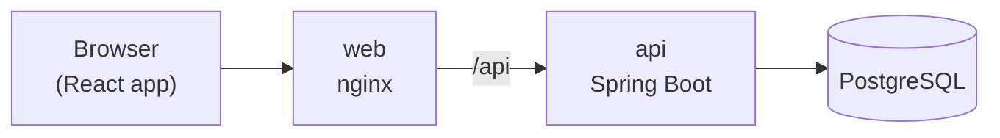

# Business Invoice Tracker

A web app for small businesses to create invoices, record payments and keep track of who still owes them money. When an invoice goes unpaid, the system sends reminders to the customer automatically. In this project the emails and SMSes are simulated: they're saved and shown in the app instead of actually being sent.

Built with Java 21 + Spring Boot on the backend, React + TypeScript on the frontend, and PostgreSQL for storage.

For a deeper look at how it's designed, see [ARCHITECTURE.md](ARCHITECTURE.md).

---

## 1. Getting started

Pick the option that matches your machine.

| Option | Best for | What you need |
|---|---|---|
| **A. Docker Desktop** | Windows and macOS | Docker Desktop |
| **B. Rancher Desktop** | Windows and macOS, if you use Rancher instead of Docker Desktop | Rancher Desktop, set to the `dockerd (moby)` engine |
| **C. Docker Engine** | Linux | Docker Engine with the Compose plugin |
| **D. Without Docker** | Working on the code | Java 21, Node 22, PostgreSQL 16 |

Options A, B and C all end with the same command. Option D runs each part yourself.

### Before you start (all options)

- About **4 GB of free memory** and **5 GB of disk space**.
- Ports **3000** and **8080** free on your machine. If they're in use, see [Changing ports](#changing-ports).
- Git, to clone the repo.

```bash
git clone https://github.com/EmmanuelManana/business-invoice-tracker.git
cd business-invoice-tracker
```

### Option A: Docker Desktop (Windows / macOS)

1. Install [Docker Desktop](https://www.docker.com/products/docker-desktop/) and start it.
2. **Windows only:** in *Settings → General*, make sure **Use the WSL 2 based engine** is ticked.
3. In *Settings → Resources*, give it at least **4 GB of memory** (the default is usually fine).
4. Check it's working:
   ```bash
   docker compose version
   ```
5. Start the app:
   ```bash
   docker compose up --build
   ```

### Option B: Rancher Desktop (Windows / macOS)

Rancher Desktop works too, but it needs one setting changed: it must use Docker's engine, not containerd.

1. Install [Rancher Desktop](https://rancherdesktop.io/) and open it.
2. Go to **Preferences → Container Engine** and choose **dockerd (moby)**. *This is the important one. With `containerd` the `docker` command won't work.*
3. Go to **Preferences → Kubernetes**. You can untick **Enable Kubernetes**. This app doesn't need it, and Rancher starts faster without it.
4. Go to **Preferences → Virtual Machine** and give it at least **4 GB of memory** and **2 CPUs**.
5. Click **Apply** and wait until the status at the bottom says it's ready.
6. Check it's working:
   ```bash
   docker version
   ```
   You should see both a *Client* and a *Server* section. If it says it can't connect, Rancher is still starting or is set to containerd.
7. Start the app:
   ```bash
   docker compose up --build
   ```

> If you prefer the command line, steps 2–5 can be done in one go:
> `rdctl start --container-engine.name=moby --kubernetes.enabled=false`

### Option C: Docker Engine (Linux)

1. Install Docker Engine and the Compose plugin by following the [official guide](https://docs.docker.com/engine/install/) for your distribution. Version 24 or newer.
2. Let your user run Docker without `sudo` (log out and back in afterwards):
   ```bash
   sudo usermod -aG docker $USER
   ```
3. Check it's working:
   ```bash
   docker compose version
   ```
4. Start the app:
   ```bash
   docker compose up --build
   ```

### After `docker compose up --build`

The first build takes a few minutes while Maven and npm download everything. Later starts are much faster. When the log stops scrolling and all three services are up, open:

| What | Address |
|---|---|
| **The app** | http://localhost:3000 |
| API docs (Swagger) | http://localhost:8080/swagger-ui.html |
| Health check | http://localhost:8080/health/ready |

**Sign in with:**

- Email: `demo@acme.co.za`
- Password: `Demo@12345`

This demo account comes with sample customers and invoices in every state, including some that are already overdue. You can also register your own business from the sign-in page.

You don't need a `.env` file. Sensible local defaults are built into `docker-compose.yml`.

**To stop it:** press `Ctrl+C`, or run `docker compose down`. To also wipe the database and start fresh, run `docker compose down -v`.

### Option D: Running without Docker

Use this if you want to work on the code with hot reload.

**You need:**

| Tool | Version | Check with |
|---|---|---|
| Java (JDK) | 21 | `java -version` |
| Node.js | 22 (20 also works) | `node -v` |
| PostgreSQL | 16 | `psql --version` |

You don't need to install Maven; the project includes its own (`mvnw`).

**Step 1: Database.** Create a database called `invoice_tracker`, owned by a user `invoice_tracker` with password `invoice_tracker`. If you have Docker but no local Postgres, this one-liner does it:

```bash
docker run -d --name invoice-db -p 5432:5432 -e POSTGRES_DB=invoice_tracker -e POSTGRES_USER=invoice_tracker -e POSTGRES_PASSWORD=invoice_tracker postgres:16-alpine
```

**Step 2: Backend.** In one terminal, build once and then start the API:

```bash
cd backend
./mvnw install -DskipTests
./mvnw -pl api spring-boot:run -Dspring-boot.run.profiles=dev
```

On Windows Command Prompt or PowerShell, use `mvnw.cmd` instead of `./mvnw`. The API starts on http://localhost:8080, creates the tables, and loads the demo data. The `dev` profile turns on the demo features and uses a local-only secret, so no extra setup is needed.

**Step 3: Frontend.** In a second terminal:

```bash
cd frontend
npm install
npm run dev
```

Open **http://localhost:5173** and sign in with the demo account above.

### Changing ports

If 3000 or 8080 are taken, copy `.env.example` to `.env` and change `WEB_PORT` and/or `API_PORT`, then run `docker compose up` again.

### Something not working?

| Problem | Fix |
|---|---|
| `Cannot connect to the Docker daemon` | Docker Desktop / Rancher isn't running yet, or Rancher is set to containerd (see Option B, step 2). |
| `port is already allocated` | Something else is using 3000 or 8080. See [Changing ports](#changing-ports). |
| The app loads but you can't sign in | Wait a few more seconds. The API may still be starting. Check http://localhost:8080/health/ready says `UP`. |
| Build is very slow or runs out of memory | Give Docker / Rancher more memory (4 GB or more). |
| `not enough space on the disk` / `no space left on device` | Free some disk space. `docker system prune` removes unused Docker images and build cache. |

---

## 2. What it does

- **Accounts:** each business registers and signs in. A business can only ever see its own data.
- **Customers:** add, edit, search and delete the people you invoice.
- **Invoices:**
  - Add line items with VAT (15% or zero). The server works out the totals, so the browser can't tamper with them.
  - Invoice numbers run in order per year, like `INV-2026-0001`.
  - An invoice moves through **Draft → Sent → Partially paid → Paid**. It becomes **Overdue** if it isn't paid by the due date, and can be **Cancelled** any time before it's paid.
  - Record full or partial payments. Clicking "save" twice won't record the same payment twice.
  - Every change is logged in the invoice's activity history.
  - Download any invoice as a PDF.
- **Reminders:** a background job runs every minute. It marks late invoices as overdue and sends reminders 3 days before the due date, on the due date, and 1, 7 and 14 days after. Each reminder is sent only once.
- **Notifications:** a bell in the top bar shows unread alerts, and a notifications page lists every reminder that was "sent".
- **Dashboard:** totals for outstanding, overdue and paid-this-month, a chart of how old the unpaid amounts are, and the most overdue invoices.

## 3. Trying out the overdue reminders

You don't have to wait days to see reminders. The dashboard has a **Demo time machine** that moves the app's clock forward.

1. Sign in and go to **Invoices → New invoice**.
2. Pick a customer (e.g. *Karoo Coffee Roasters*), set the **due date to tomorrow**, add a line item and click **Save draft**.
3. Click **Mark as sent**.
4. Go back to the **Dashboard** and click **+7 days**, then **Run overdue check now**.
5. The bell now shows new notifications. Open **Notifications** to read the reminder emails and SMSes, and the alert that your invoice is overdue.
6. Click **Run overdue check now** again: nothing new is sent, because each reminder only goes out once.
7. Click **Reset** to put the clock back to today.

The time machine is for demos only. It's switched off unless `APP_DEV_TOOLS_ENABLED=true`, which the Docker setup turns on for you.

## 4. Running the tests

| What | Command |
|---|---|
| Backend: everything (needs Docker running) | `cd backend && ./mvnw verify` |
| Backend: unit tests only (no Docker needed) | `cd backend && ./mvnw test` |
| Frontend: unit tests | `cd frontend && npm test` |
| Frontend: lint and type checks | `cd frontend && npm run lint && npm run typecheck` |
| End-to-end (with the app running via Docker) | `cd frontend && npx playwright install chromium && npm run e2e` |

The backend's full test run starts a real PostgreSQL in Docker (via Testcontainers) to test the API end to end, including that one business can't see another's data.

**Don't want to install Java or Node?** You can run the tests inside Docker instead:

```bash
docker compose -f docker-compose.yml -f docker-compose.test.yml run --rm backend-tests
docker compose -f docker-compose.yml -f docker-compose.test.yml run --rm frontend-tests
docker compose -f docker-compose.yml -f docker-compose.test.yml run --rm e2e
```

Every push to GitHub runs all of this automatically (see `.github/workflows/ci.yml`).

**Manual testing:** [`docs/testing/manual-test-script.md`](docs/testing/manual-test-script.md) is a 20-step script for testing the app like a real user, with screenshots. Results go in [`docs/testing/manual-test-report.md`](docs/testing/manual-test-report.md).

## 5. How it's put together

A short overview. The full write-up, with diagrams of the layers, data model, invoice lifecycle and reminder job, plus security and design decisions, is in [ARCHITECTURE.md](ARCHITECTURE.md).



- **web**: nginx serves the React app and forwards `/api` requests to the backend, so everything runs on one address.
- **api**: the Spring Boot backend. It's split into four layers so the business rules don't depend on the database or web framework:
  - `domain`: the core rules (invoice states, VAT, payments, reminder schedule)
  - `application`: what users can do (create invoice, record payment, run the overdue check)
  - `infrastructure`: database, security, the background job, the simulated email/SMS senders
  - `api`: the REST endpoints
- **db**: PostgreSQL. Tables are created automatically on start-up.

A few decisions worth knowing about:

- **Money** is stored as exact decimals, never floating point, and rounded per line so line totals always add up.
- **Simulated notifications:** reminders are written to a `notifications` table, then handed to a sender for each channel. The included senders just log the message. To send real emails or SMSes, you'd add a sender for a provider such as SendGrid or Twilio. Nothing else would need to change.
- **No duplicate reminders:** the database refuses a second reminder for the same invoice, stage and channel. A lock makes sure only one copy of the job runs at a time, even with several servers.
- **Sign-in:** short-lived access tokens are kept in memory. A longer-lived refresh token sits in a secure cookie that JavaScript can't read.

## 6. Settings

You only need these if you're changing the defaults. Put them in a `.env` file (copy `.env.example`).

| Setting | Default | What it does |
|---|---|---|
| `APP_AUTH_JWT_SECRET` | demo value | Secret used to sign logins. **Must be changed for real use** (at least 32 characters). |
| `POSTGRES_PASSWORD` | demo value | Database password. Change for real use. |
| `APP_DEV_TOOLS_ENABLED` | `true` in Docker | Turns the demo time machine on or off. Turn off for real use. |
| `APP_SEED_ENABLED` | `true` in Docker | Loads the demo business on start-up. |
| `APP_SEED_DEMO_PASSWORD` | `Demo@12345` | Password for the demo account. |
| `APP_OVERDUE_INTERVAL` | `PT1M` (1 minute) | How often the reminder job runs. |
| `APP_REMINDERS_OFFSETS_DAYS` | `-3,0,1,7,14` | When reminders are sent, in days relative to the due date. |
| `APP_AUTH_COOKIE_SECURE` | `false` in Docker | Set to `true` when the site is served over HTTPS. |
| `WEB_PORT` / `API_PORT` | `3000` / `8080` | Ports on your machine. |

## 7. API

The full, interactive list is in Swagger at http://localhost:8080/swagger-ui.html. In short, everything lives under `/api/v1`:

| Area | Endpoints |
|---|---|
| Sign-in | `POST /auth/register`, `/auth/login`, `/auth/refresh`, `/auth/logout`, `GET /auth/me` |
| Business profile | `GET` / `PUT /business/profile` |
| Customers | `GET` / `POST /customers`, `GET` / `PUT` / `DELETE /customers/{id}` |
| Invoices | `GET` / `POST /invoices`, `GET` / `PUT /invoices/{id}`, `POST /invoices/{id}/send`, `/cancel`, `/payments`, `GET /invoices/{id}/activity`, `/pdf` |
| Notifications | `GET /notifications`, `/notifications/unread-count`, `POST /notifications/{id}/read`, `/notifications/read-all` |
| Dashboard | `GET /dashboard/summary` |
| Demo tools | `GET /dev/clock`, `POST /dev/clock/advance`, `/dev/clock/reset`, `/dev/overdue-check` |

Errors come back in a consistent JSON format with a short error code and a message that explains what went wrong.

## 8. Limitations and ideas for later

**Kept simple on purpose:**

- One user per business, and one currency per business (ZAR by default).
- "Sending" an invoice marks it as sent and starts the reminders. The invoice itself isn't emailed.
- Payments can't be edited or refunded once recorded.
- The demo time machine moves the clock for everyone using that server, which is why it's off by default.

**What I'd add next:**

- Real email and SMS providers, with delivery tracking and a way for customers to opt out.
- Email the invoice PDF to the customer when it's sent.
- Team members with different roles.
- Credit notes, recurring invoices and multiple currencies.
- Monitoring dashboards (metrics and tracing).
