# Manual Test Report — Business Invoice Tracker

> **Evidence note:** screenshots were captured during the run but could not be saved as files from the test browser. The image links below use the planned file names in `docs/testing/evidence/`; they will render once those files are added (see `evidence/README.md`).

## 1. Summary
| Item | Value |
|---|---|
| Date / time | Tue 03 Nov 2026, 14:58–15:10 SAST |
| Run ID | 1458 |
| Browser | Google Chrome, viewport 1150×631 |
| Tester | Manual run in Google Chrome |
| App URL | http://localhost:3000 |
| **Totals** | **PASS 19 · FAIL 0 · BLOCKED 1** (out of 20) |

All required functional behaviour passed. Six defects were logged: two Medium and four Low. The most important is that invoice statuses stay "Overdue" after the demo clock is reset.

## 2. Results
| ID | Test | Result | Notes |
|---|---|---|---|
| TC-01 | Sign-in rejects wrong details | PASS | |
| TC-02 | Sign-in validation | PASS | Old "Invalid email or password" banner stays visible (D4) |
| TC-03 | Successful sign-in and dashboard | PASS | Overdue count disagrees with age buckets (D1) |
| TC-04 | Create / search / edit customer | PASS | |
| TC-05 | Draft invoice, server totals | PASS | INVOICE-A = INV-2026-0021 |
| TC-06 | Edit draft | PASS | R 5 425,00, then back to R 3 700,00 |
| TC-07 | Send invoice | PASS | |
| TC-08 | Partial payment + validation | PASS | |
| TC-09 | Pay the rest | PASS | |
| TC-10 | Download PDF | PASS | GET /api/v1/invoices/…/pdf returned 200 and downloaded; contents not viewed |
| TC-11 | Cancel invoice | PASS | INVOICE-C = INV-2026-0022; balance still shown (D6) |
| TC-12 | Search, filter, sort | PASS | 7 of 12 "Overdue" invoices not yet due (D1); horizontal overflow (D2) |
| TC-13 | Delete rules | PASS | Confirm dialog stays open after rejection (D5) |
| TC-14 | Invoice goes overdue | PASS | INVOICE-B = INV-2026-0023 |
| TC-15 | Notification centre | PASS | |
| TC-16 | Reminders sent only once | PASS | |
| TC-17 | Business profile | PASS | |
| TC-18 | Sign out, protection, tenant isolation | PASS | Time machine is shared across tenants (D3) |
| TC-19 | Mobile layout | BLOCKED | Window could not be resized (stayed 1150px wide); environment limitation |
| TC-20 | Reset clock | PASS | |

## 3. Details

**TC-01 — PASS.** Signing in with demo@acme.co.za and "wrong-password" showed a red "Invalid email or password" banner, and the page stayed on Sign in.
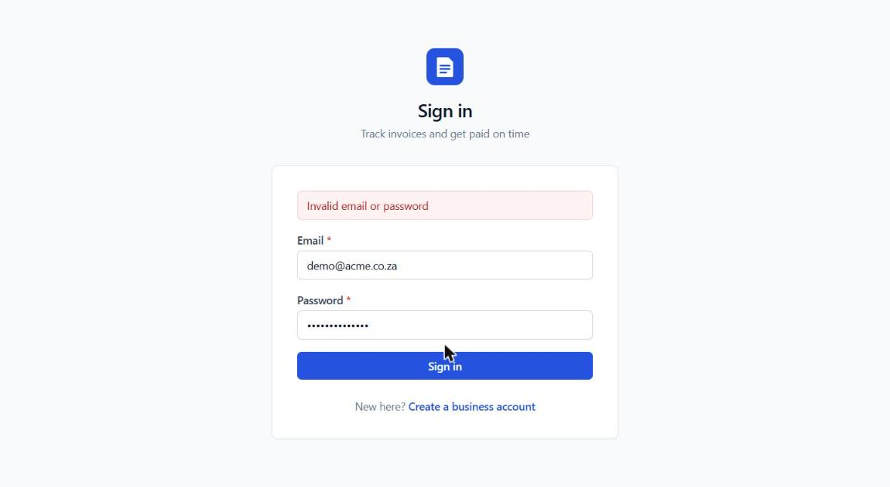 — Red error banner on the sign-in page.

**TC-02 — PASS.** Field errors appeared: "Enter a valid email address" and "Password is required". Nothing was submitted. The red banner from TC-01 was still showing above the form (D4).
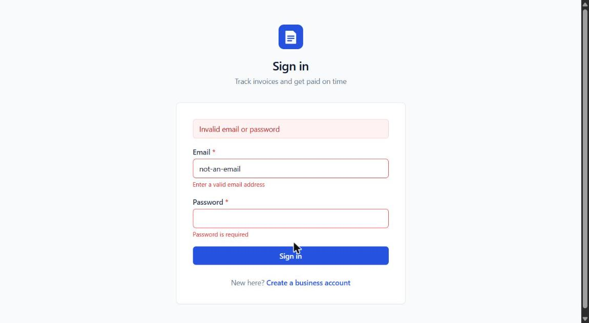 — Both field errors, with the stale banner.

**TC-03 — PASS.** Card values:
- Total outstanding R 160 425,00
- Total overdue R 77 970,00
- Paid this month R 36 800,00

Invoices by status: Draft 2, Sent 1, Partially Paid 1, Overdue 12, Paid 3, Cancelled 1.

The age chart and table were present: Current 9, 1-30 2, 31-60 1, 61-90 1, 90+ 1. The Most overdue list showed 5 invoices, and the amber time machine card showed 03 Nov 2026.

Note: the card says 12 Overdue, but only 5 invoices are past due by age (see D1).
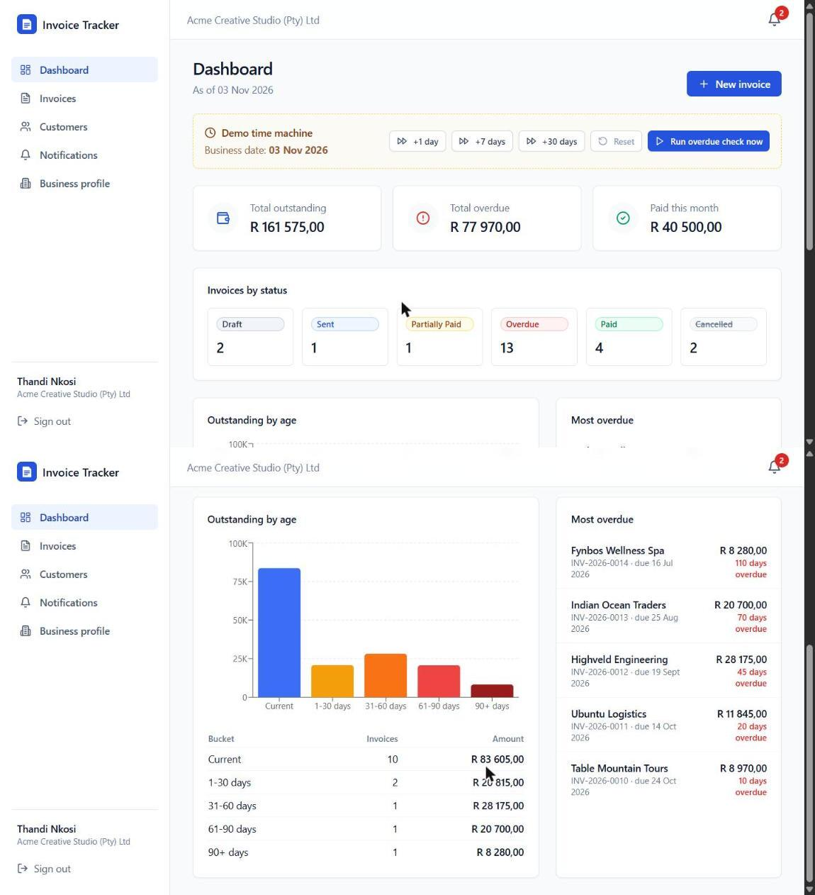 — Dashboard cards, status row and time machine.

**TC-04 — PASS.**
- Empty submit showed "Name is required" and "Email is required".
- Saving showed the toast "QA Customer 1458 added" and the customer appeared in the list.
- Search narrowed the list to 1 result.
- Editing the city showed the toast "Customer updated", and the City column changed to Stellenbosch.

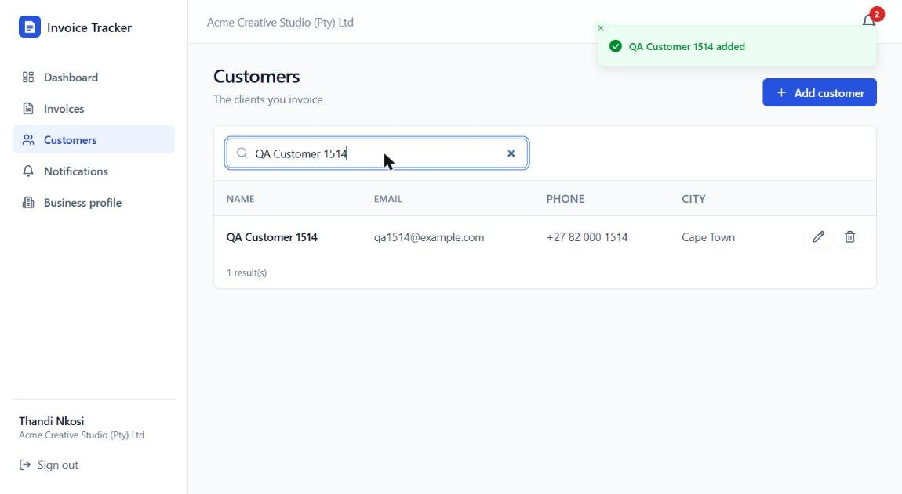 — Toast and new row.

**TC-05 — PASS.**
- Empty save showed "Choose a customer" and "Description is required".
- The form preview showed Subtotal R 3 250,00, VAT R 450,00, Total R 3 700,00.
- Saving showed the toast "Draft INV-2026-0021 created" and status Draft.
- The saved invoice matched the preview, with Balance due R 3 700,00. Activity showed "Invoice INV-2026-0021 created".
- Page address: /invoices/307f09f1-2099-4b90-bc76-07b76c58fdf5

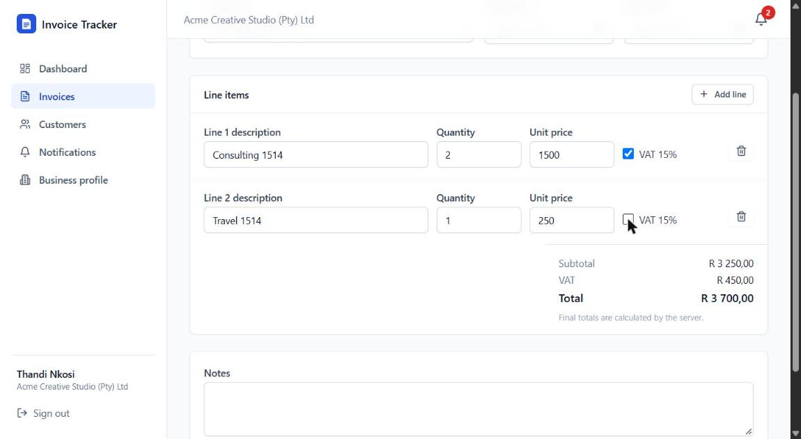 — Preview totals before saving.
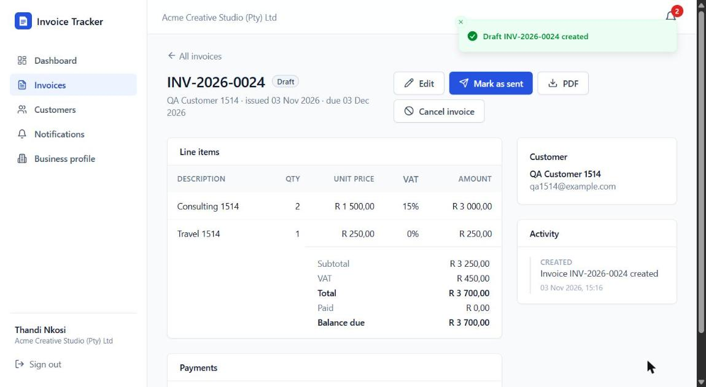 — Saved draft with server totals.

**TC-06 — PASS.** Quantity 3 gave the toast "INV-2026-0021 updated", a total of R 5 425,00 and "Draft updated" in Activity. Quantity 2 brought the total back to R 3 700,00.

**TC-07 — PASS.**
- Toast "INV-2026-0021 marked as sent"; the badge showed Sent.
- Edit and Mark as sent were gone; Record payment appeared.
- Activity showed "Invoice sent to qa1458@example.com".

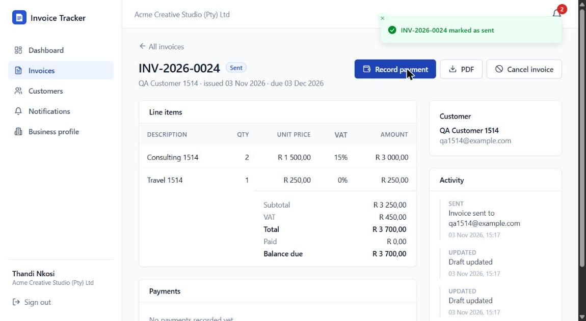 — Sent status and new buttons.

**TC-08 — PASS.**
- An amount of 5000 showed "Cannot exceed the balance of 3700.00".
- 1000 by EFT showed the toast "Payment recorded", status Partially Paid and Balance due R 2 700,00.
- Payments listed R 1 000,00 · EFT · QA-1458-1.

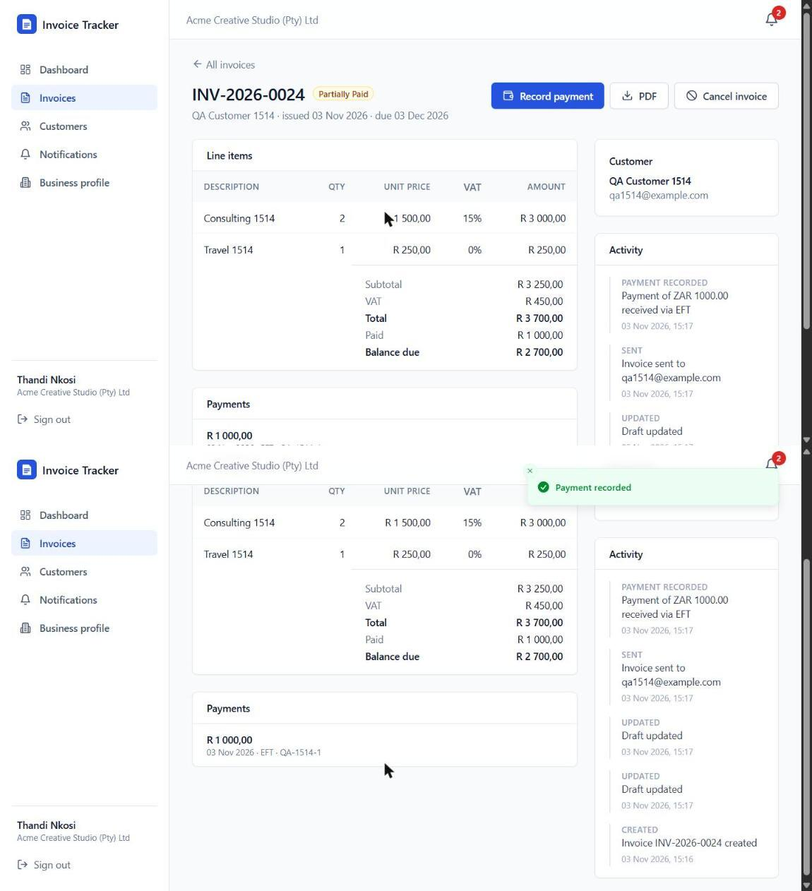 — Partially Paid with R 2 700,00 due.

**TC-09 — PASS.**
- The amount was pre-filled with 2700.
- After saving: status Paid, Balance due R 0,00, two payments listed, and "Invoice paid in full" in Activity.
- Only the PDF button remained.

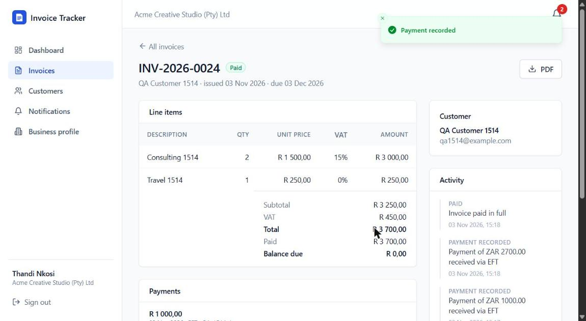 — Paid invoice.

**TC-10 — PASS.** Clicking PDF requested GET /api/v1/invoices/307f09f1…/pdf, which returned HTTP 200, and the browser downloaded the file. The contents (TAX INVOICE, lines, totals) could not be viewed from the tester's tools.
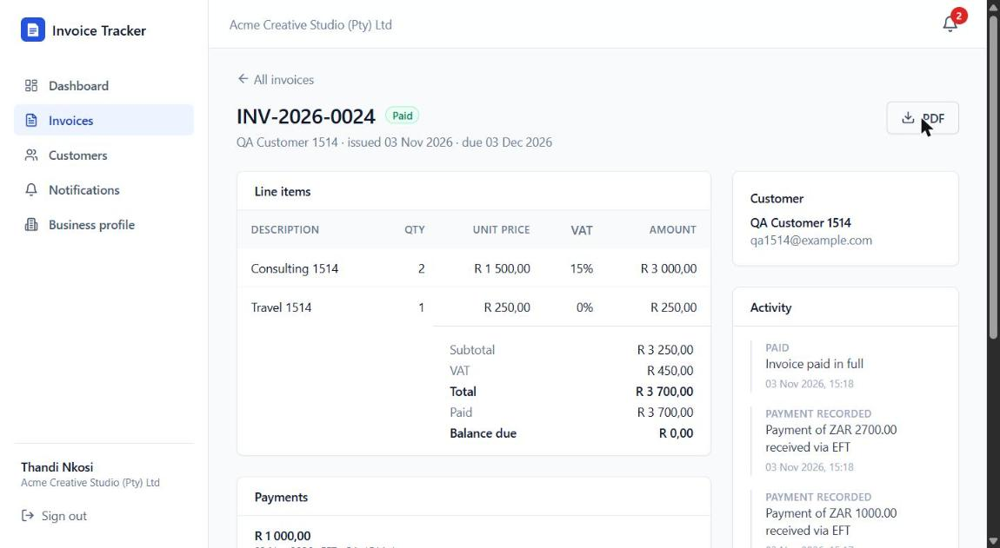 — Invoice page after clicking PDF.

**TC-11 — PASS.**
- Created INV-2026-0022 (R 115,00) and cancelled it with the reason "QA cancellation".
- Toast "INV-2026-0022 cancelled"; the badge showed Cancelled, struck through.
- The Customer panel showed "Cancelled: QA cancellation", and Activity matched.
- The page still showed "Balance due R 115,00" (D6).

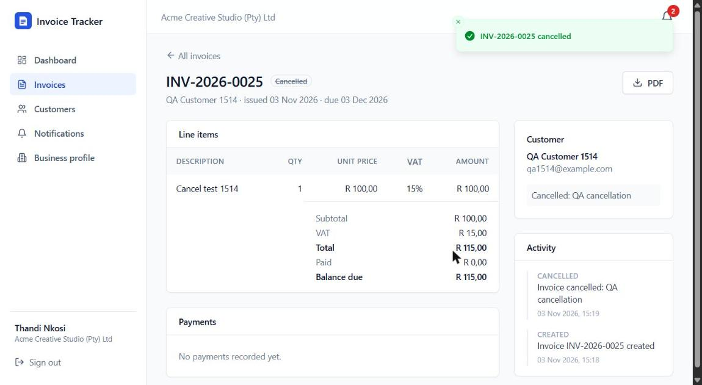 — Cancelled invoice.

**TC-12 — PASS.**
- Searching "1458" listed only INV-2026-0022 and INV-2026-0021.
- The Overdue filter changed the URL to ?status=OVERDUE and listed 12 invoices, all Overdue.
- Clicking the Total header sorted highest first (↓), then lowest first (↑).

Two issues showed up here:
- 7 of the listed invoices have due dates of 04–06 Nov 2026, which were still in the future on 03 Nov (D1).
- A horizontal scrollbar appears because the filter row overflows (D2).

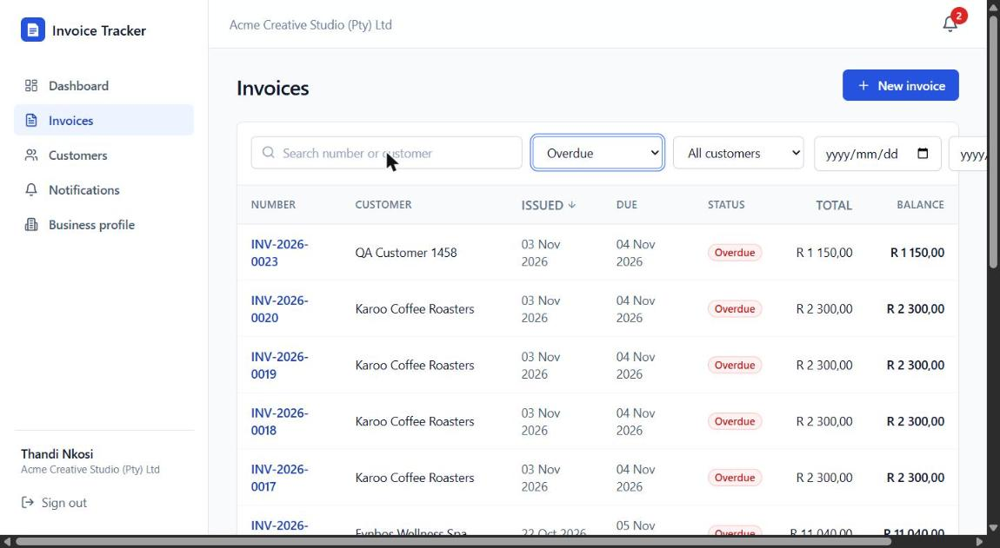 — Overdue filter results.

**TC-13 — PASS.**
- Deleting QA Customer 1458 showed the red toast "This customer has invoices and cannot be deleted", and the customer stayed. The confirm dialog stayed open (D5).
- "Delete Me 1458" was added, then deleted with the toast "Customer deleted".

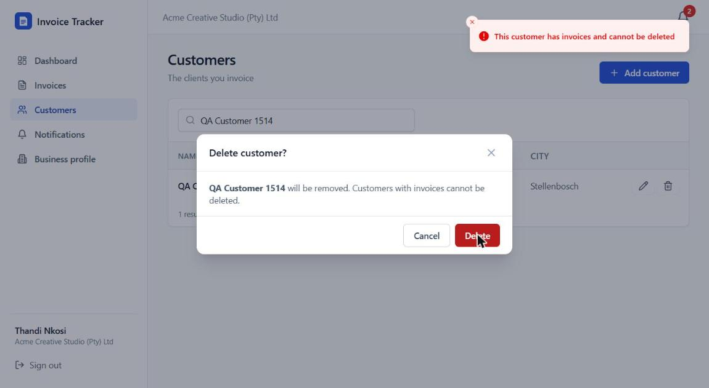 — Red toast, dialog still open.

**TC-14 — PASS.**
- INV-2026-0023 was created due 04 Nov and sent. The bell showed 46.
- "+7 days" showed the toast "Business date is now 10 Nov 2026" and "(+7 days simulated)".
- "Run overdue check now" showed "Overdue check done: 1 newly overdue, 2 reminder(s) and 1 alert(s) sent." The bell went from 46 to 49.
- INVOICE-B showed Overdue, "6 days overdue", "Invoice became overdue", and "1 day overdue reminder sent via EMAIL" and "via SMS".

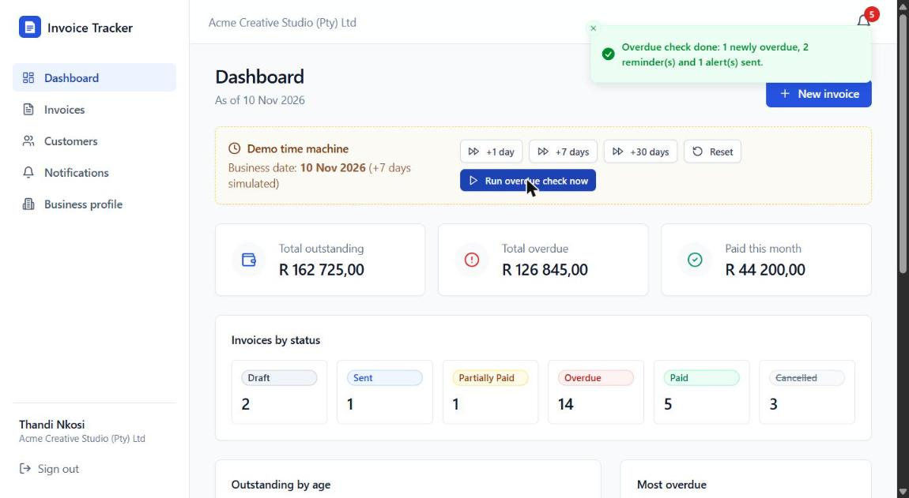 — Overdue check toast.
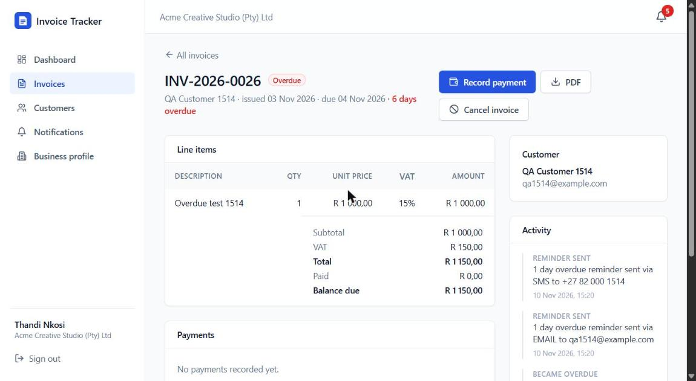 — INVOICE-B overdue with activity.

**TC-15 — PASS.**
- The bell dropdown listed 6 items, each with an Email/SMS/Alert badge, a time and a subject.
- The full page showed 49 results over 3 pages.
- The alert "INV-2026-0023 for QA Customer 1458 is overdue" expanded to the full message, "Attempts: 1" and a "View INV-2026-0023" link.
- The Email and SMS reminders for INV-2026-0023 were listed as SENT.
- The email began "Dear QA Customer 1458," and mentioned INV-2026-0023, "6 day(s) overdue" and ZAR 1150.00.

The list also contains alerts dated "10 Nov 2026, 13:09–13:21" from an earlier time-travel run today.
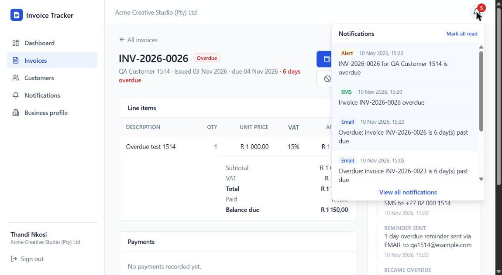 — Six newest notifications.
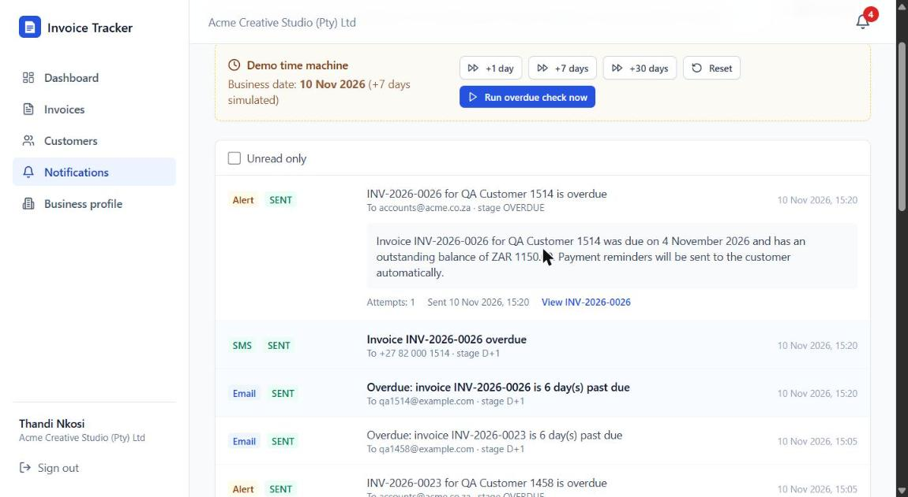 — Expanded alert for INVOICE-B.

**TC-16 — PASS.** Re-running the check showed "0 newly overdue, 0 reminder(s) and 0 alert(s) sent." with no new rows. "Mark all read" cleared the bell badge, and "Unread only" showed "All caught up".
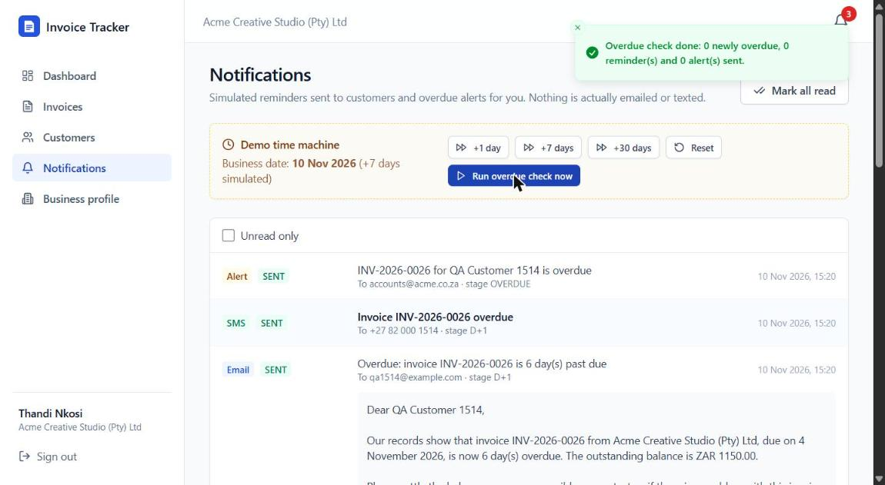 — Zero-count toast.

**TC-17 — PASS.** VAT number 123 showed "A South African VAT number has 10 digits and starts with 4". VAT 4123456789 with phone +27 21 555 1458 showed the toast "Business profile saved". After a full reload of /settings, the phone was still +27 21 555 1458.
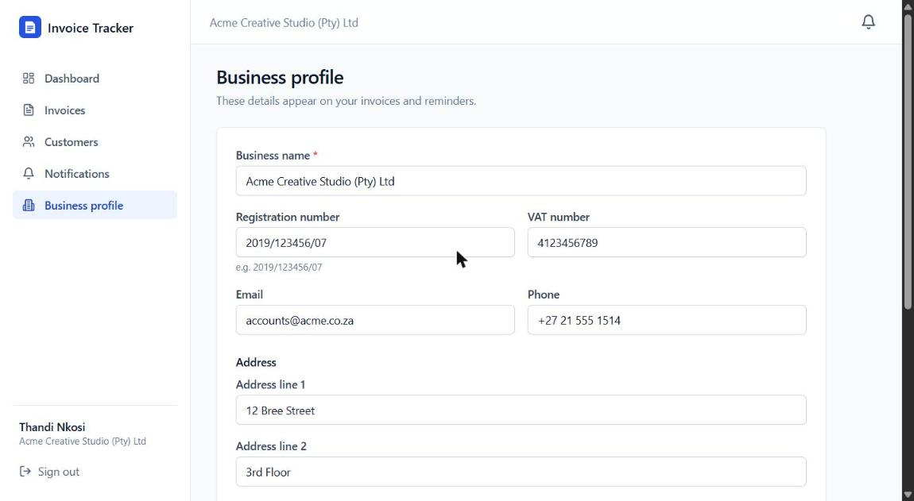 — Profile after reload.

**TC-18 — PASS.**
- Sign out showed the toast "Signed out". Opening /invoices redirected to /login.
- Registering "QA Business 1458" showed the toast "Welcome! Your business account is ready.", R 0,00 on every card and all counts 0.
- Invoices showed "No invoices yet" and Customers showed "No customers yet".
- Opening INVOICE-A's address showed "Couldn't load this" and "Invoice 307f09f1-… was not found".

The new business's dashboard also showed "Business date: 10 Nov 2026 (+7 days simulated)" (D3).
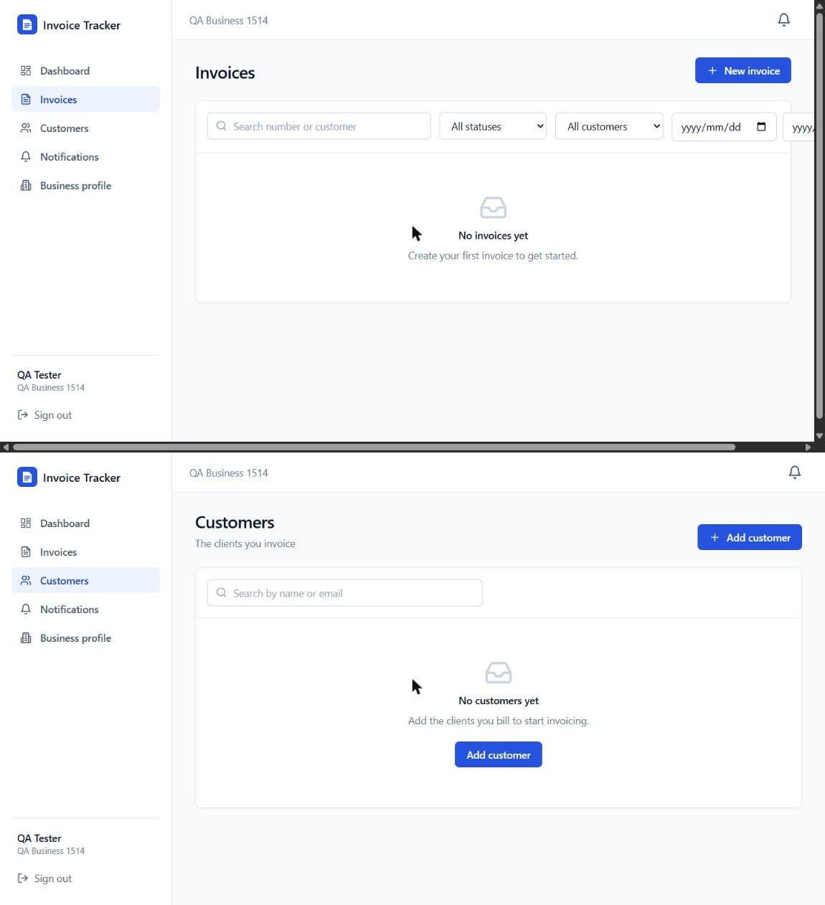 — Empty invoices list for the new tenant.
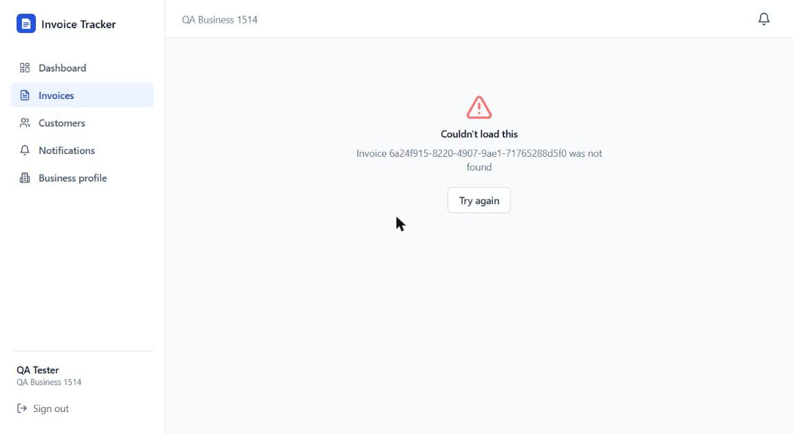 — "was not found" for another tenant's invoice.

**TC-19 — BLOCKED.** The window resize to 390×844 had no effect; the viewport stayed 1150px wide, probably because the window is maximised with the side panel open. The mobile layout should be re-tested manually or with DevTools device mode.
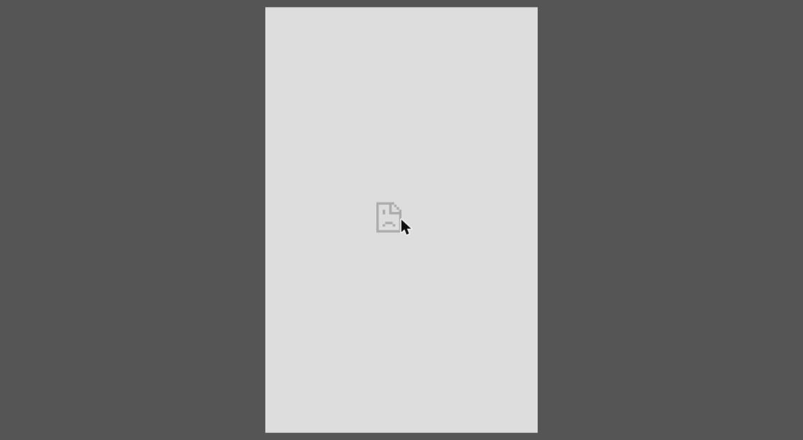 — Viewport unchanged after the resize attempt.

**TC-20 — PASS.** Signed in as demo and clicked Reset. The toast said "Clock reset to real time" and the business date went back to 03 Nov 2026 with no "simulated" label. After the reset, the Overdue count was **13**, which now includes INVOICE-B, still not due until 04 Nov (D1).
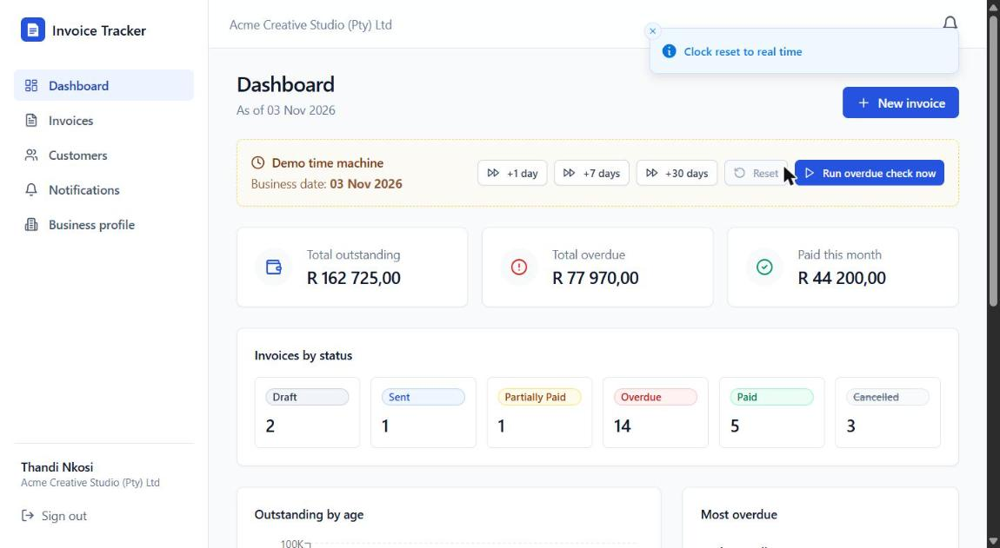 — Clock reset.

## 4. Defects found

### D1 — Invoices stay "Overdue" after the clock is reset (Medium)
**Steps**
1. Create and send an invoice due tomorrow.
2. Click "+7 days", then "Run overdue check now".
3. Click Reset.
4. Look at the invoice and the dashboard.

**Expected:** after the reset the invoice is no longer overdue, and the dashboard status count agrees with the age buckets.
**Actual:** the invoice stays Overdue. After TC-20 the dashboard shows 13 Overdue, but only 5 invoices are past due by age. The others include INV-2026-0017 to 0020, 0004, 0005, 0016 and 0023, all due 04–06 Nov, flipped by earlier runs at 13:09–13:21 and by this one.
**Effect:** wrong status badges and counts, and misleading dashboard figures.
**Evidence:** TC-03, TC-12, TC-20.

### D2 — Invoices filter row overflows on desktop (Low)
**Steps:** open Invoices at a 1150px-wide viewport.
**Expected:** no sideways scrolling.
**Actual:** a horizontal scrollbar appears. The page scroll width is 1238px against a 1150px viewport, and the second "Issued to" date field is cut off.
**Evidence:** TC-12.

### D3 — The demo time machine is shared by all businesses (Medium)
**Steps:** move the clock as the demo business, then register or sign in as a different business.
**Expected:** each business has its own simulated date, or the feature is limited to the demo account.
**Actual:** the new business also showed "10 Nov 2026 (+7 days simulated)", and its user had the Reset and +N controls. Any business can change the date that every other business sees.
**Evidence:** TC-18.

### D4 — Server error banner stays visible during client validation (Low)
**Steps:** sign in with a wrong password, then submit an invalid email with an empty password.
**Expected:** the old "Invalid email or password" banner is cleared.
**Actual:** the banner stays visible alongside the new field errors.
**Evidence:** TC-02.

### D5 — Delete-customer dialog stays open after the server refuses (Low)
**Steps:** try to delete a customer who has invoices.
**Expected:** the dialog closes and the error toast shows.
**Actual:** the toast shows, but the "Delete customer?" dialog stays open with the Delete button still active.
**Evidence:** TC-13.

### D6 — Cancelled invoice still shows a balance due (Low)
**Steps:** cancel an unpaid draft.
**Expected:** Balance due shows R 0,00, is hidden, or is labelled as void.
**Actual:** the invoice page and the list's Balance column both show R 115,00 for INV-2026-0022.
**Evidence:** TC-11.

## 5. Test data created
| Item | Value |
|---|---|
| Customer | QA Customer 1458 · qa1458@example.com · +27 82 000 1458 · Stellenbosch |
| Throwaway customer | Delete Me 1458 (deleted) |
| INVOICE-A | INV-2026-0021, R 3 700,00, **Paid** (EFT 1000 ref QA-1458-1, then EFT 2700) · /invoices/307f09f1-2099-4b90-bc76-07b76c58fdf5 |
| INVOICE-B | INV-2026-0023, R 1 150,00, due 04 Nov 2026, **Overdue** (still Overdue after the reset; see D1) · /invoices/9c78e77a-5220-49a4-97e1-641bb07eb2a7 |
| INVOICE-C | INV-2026-0022, R 115,00, **Cancelled** ("QA cancellation") |
| Business profile | Phone changed to +27 21 555 1458 (VAT still 4123456789) |
| Registered business | QA Business 1458 · owner QA Tester · qa-owner1458@example.com |
| Clock | Reset to real time (03 Nov 2026) |
